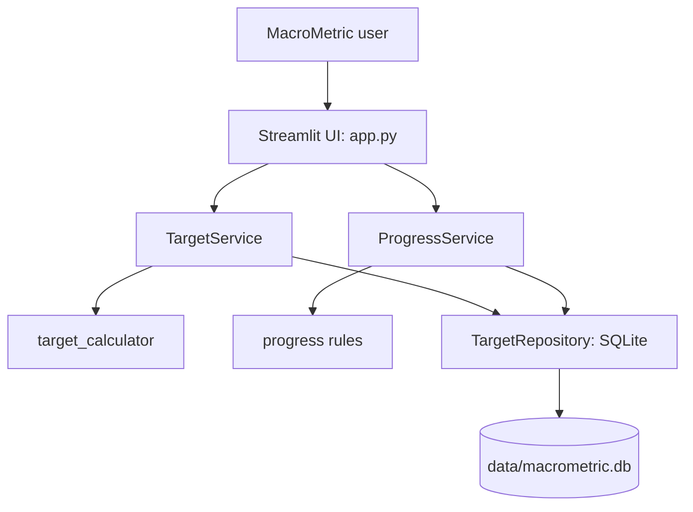
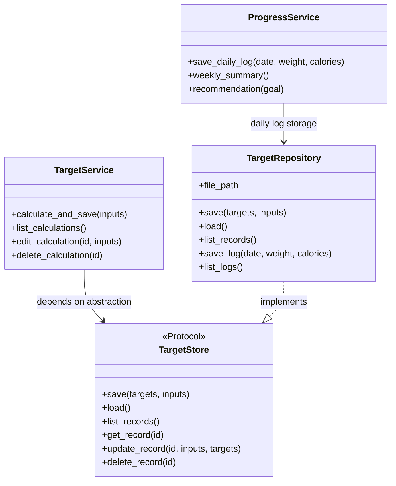
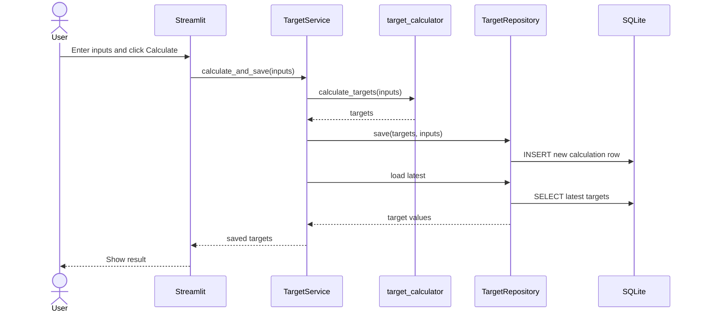

# MacroMetric

[](https://github.com/CMend137/cen5064-project-mendoza/actions/workflows/ci.yml)

**Course:** CEN 5064 Software Design, Fall 2026  
**Student:** Carlos Mendoza  
**Peer-review partner:** [@JMorency13](https://github.com/JMorency13)

## Purpose and delivered use cases

MacroMetric is a local nutrition target and progress application, built in Python and Streamlit. Its implemented workflows are:

1. **Calculate** daily calories and protein/carbohydrate/fat targets from measurements, activity level, and goal.
2. **Track** daily calorie intake and body weight by date (create, view, edit by re-saving a date, delete).
3. **View** weight and calorie trends over the last seven days, including weekly averages.
4. **Receive** simple, transparent, rule-based feedback based on recent weight changes and saved goal.

The application also stores **every calculation**, instead of overwriting the last one. Users can view the full history, edit a saved calculation (which reruns domain logic), or delete it. The interface is organized into five tabs: Calculator, Calculation History, Daily Log, Weekly Trends, and Recommendations.

## Run from a clean clone

Prerequisites: **Python 3.12**, `pip`, and an internet connection for package installation. No database server or API keys are required.

```bash
git clone https://github.com/CMend137/cen5064-project-mendoza.git
cd cen5064-project-mendoza
python -m venv .venv
```

**Windows PowerShell**:

```powershell
.\.venv\Scripts\python.exe -m pip install -r requirements.txt
.\.venv\Scripts\python.exe -m streamlit run app.py
```

**macOS/Linux**:

```bash
.venv/bin/python -m pip install -r requirements.txt
.venv/bin/python -m streamlit run app.py
```

Open the local Streamlit URL (typically `http://localhost:8501`). SQLite creates `data/macrometric.db` on first run and retains the data between restarts. The database file is excluded from Git.

### Demonstrate the app

1. **Calculator:** enter valid measurements, choose an activity level and goal, then save a calculation. Change the goal and save again.
2. **Calculation History:** see both records, select one, edit the measurements or goal, and save. Delete the other using the confirmation checkbox.
3. **Daily Log:** enter a date, weight, and calories consumed. Save a second date. To edit an entry, select the same date and save revised values.
4. **Weekly Trends:** review weight and calorie charts and summary metrics. These show only logs from the last seven days (including today).
5. **Recommendations:** see rules associated with the most recent saved fitness goal and last seven days of logs.

For a classroom demo, use fictional values and dates within the last seven days. No personal data needs to be stored or uploaded.

## Tests

```bash
python -m pytest -q
```

CI runs `ruff check .` and `pytest -q` on pushes and PRs affecting `main`. Tests cover the calculator, validation, dependency injection, SQLite persistence and history, edit/delete, daily logging, and progress rules.

## Four-tier design

| Tier | Responsibilities | Key implementation |
|---|---|---|
| Presentation | Collect user input; show results, history, management controls, charts, messages | `app.py` (Streamlit) |
| Service | Coordinate use cases, validation, and persistence | `services/target_service.py`, `services/progress_service.py` |
| Domain | Compute nutrition targets and explain weekly rules without UI or DB code | `domain/target_calculator.py`, `domain/progress.py` |
| Data | SQLite creation, reads, inserts, updates, deletes | `data/target_repository.py`, `data/target_store.py` |

### C4 container/component view



### UML classes



### Save and retrieve a calculation



## Database model

SQLite has a `calculations` table with integer record IDs, UTC creation timestamp, original inputs, and calculated targets. Each calculation is an immutable historical event until a user explicitly edits or deletes it. `daily_logs` stores date, weight, and calories consumed; the date is unique, so re-saving the same date updates that entry. SQL is encapsulated behind the repository, not accessed directly from Streamlit or domain functions.

## Architecture Decision Records

- [ADR-001 — Python layered application](docs/adr/adr-001.md)
- [ADR-002 — Initial local JSON persistence (historical)](docs/adr/adr-002.md)
- [ADR-003 — SQLite history and daily logs (current)](docs/adr/adr-003.md)

The original calculation slice was delivered via [PR #7](https://github.com/CMend137/cen5064-project-mendoza/pull/7). The dependency inversion refactor was [PR #8](https://github.com/CMend137/cen5064-project-mendoza/pull/8). Subsequent development replaces the JSON implementation while retaining `TargetService`'s separation from specific database mechanisms.

## Limitations and next improvements

- Local single-profile tool with **no login/authentication**, user synchronization, or cloud deployment.
- New SQLite data is not automatically imported from the older `data/targets.json` single-result file.
- Simple calorie and weight calculations are estimates; progress rules are illustrative and should not be treated as professional medical or nutritional advice.
- The seven-day trend is based on recorded dates. On days with no entry, there is no estimate or interpolated value. Rule-based weight change is measured between the first and last logged dates, which may be fewer than seven days apart.
- Future work: formal database migrations, backups, user profiles, clearer goal-rate thresholds, and better edit-form behavior on repeated Streamlit reruns.

For the final conference demonstration, see [two-minute demo checklist](docs/MONDAY_DEMO.md).
