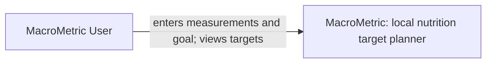
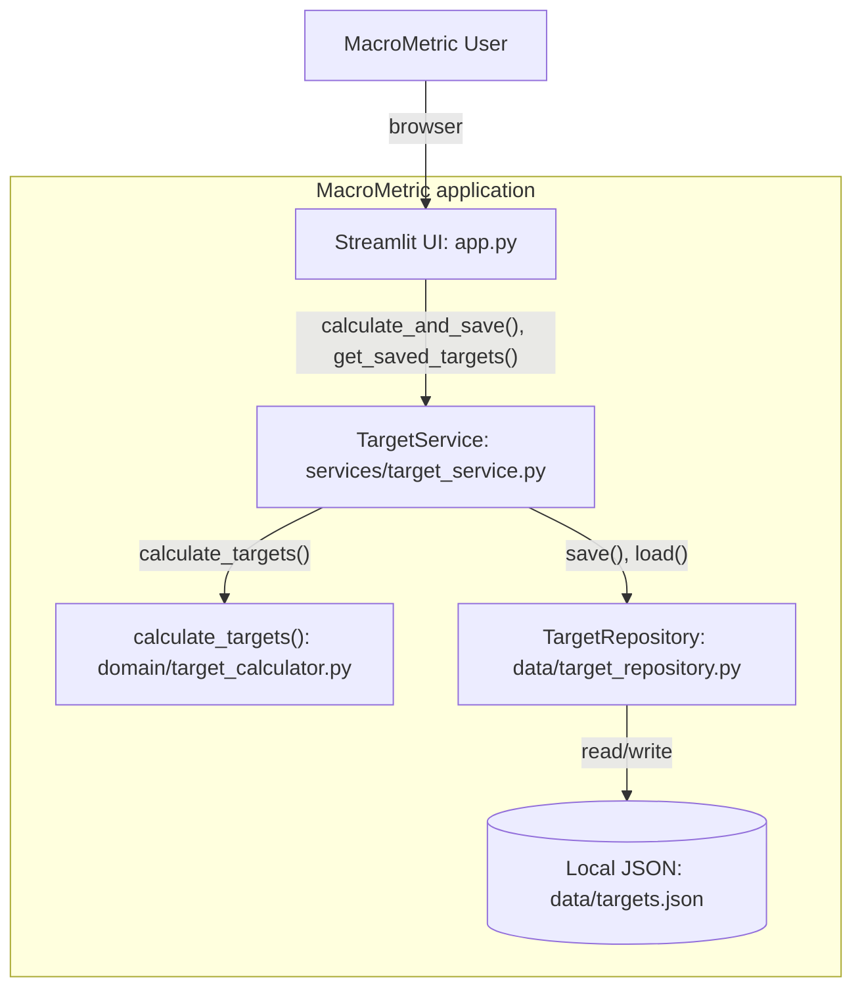
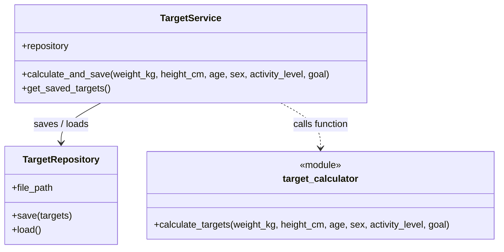
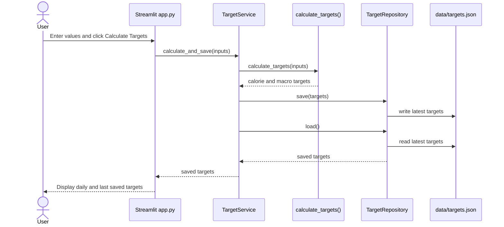

# MacroMetric

[](https://github.com/CMend137/cen5064-project-mendoza/actions/workflows/ci.yml)

**Student:** Carlos Mendoza · **Course:** CEN 5064 Software Design, Fall 2026 · **Review partner:** [@JMorency13](https://github.com/JMorency13)

## Purpose and scope

MacroMetric is a nutrition target-planning application for adults seeking to lose, maintain, or gain body weight. Four planned use cases are: (1) calculate daily calorie and macronutrient targets, (2) log daily calorie intake and body weight, (3) view weekly trends, and (4) receive transparent rule-based progress recommendations.

**Implemented for the midterm: use case 1.** Streamlit collects weight, height, age, sex, activity level, and goal. Business logic validates those values and calculates calories, protein, fat, and carbohydrate targets. The service saves the **latest** targets as local JSON; the UI shows both the calculated results and previously saved results. Daily logging, trends, and adaptive recommendations are planned, **not yet implemented**.

## How to run from a clean clone

**Prerequisites:** Python 3.12 with `pip` and `venv` (CI uses Python 3.12), and a web browser. No database server or API key is required.

### 1. Get the code

With Git installed:

```bash
git clone https://github.com/CMend137/cen5064-project-mendoza.git
cd cen5064-project-mendoza
```

Without Git, open the [repository](https://github.com/CMend137/cen5064-project-mendoza), choose **Code → Download ZIP**, extract it, and open a terminal in the directory containing `app.py` and `requirements.txt`.

### 2. Install dependencies

**Windows PowerShell:**

```powershell
python -m venv .venv
.\.venv\Scripts\python.exe -m pip install -r requirements.txt
```

**macOS / Linux:**

```bash
python3 -m venv .venv
.venv/bin/python -m pip install -r requirements.txt
```

### 3. Start MacroMetric

**Windows PowerShell:**

```powershell
.\.venv\Scripts\python.exe -m streamlit run app.py
```

**macOS / Linux:**

```bash
.venv/bin/python -m streamlit run app.py
```

Open the Streamlit local URL, usually http://localhost:8501.

### 4. Manually test the working slice

1. Enter a valid positive **Weight (kg)**, **Height (cm)**, age, sex, activity level, and goal (**Lose**, **Maintain**, or **Gain**). Click **Calculate Targets**.
2. Confirm the success message and displayed calorie, protein, carbohydrate, and fat targets.
3. Confirm **Last Saved Targets** appears below. The application automatically creates `data/targets.json` on the first save.
4. Refresh the browser or restart the Streamlit server. The previously saved targets should still be visible. On a clean machine no saved targets are shown until the first calculation.
5. Change the goal and calculate again. The new targets should replace the last saved values.

**Business rules:** `domain/target_calculator.py` uses the Mifflin–St Jeor BMR formula, activity multipliers, and calorie adjustments of −500 / 0 / +500 for lose / maintain / gain. Protein is 2 g/kg, fat is 25% of total calories, and carbohydrates receive the remaining calories. Invalid measurements, choices, or infeasible targets are rejected.

### 5. Run automated tests

**Windows PowerShell:**

```powershell
.\.venv\Scripts\python.exe -m pytest -q
```

**macOS / Linux:**

```bash
.venv/bin/python -m pytest -q
```

GitHub Actions runs `ruff check .` and `pytest -q` via [`.github/workflows/ci.yml`](.github/workflows/ci.yml) on pushes and pull requests involving `main`.

## Architecture: four tiers

| Tier | Responsibility in current working slice | Code |
|---|---|---|
| Presentation | Collect measurements/goal; show results or errors | `app.py` (Streamlit) |
| Service | Coordinate calculation, save, reload | `services/target_service.py` (`TargetService`) |
| Domain | Validate inputs and calculate nutritional targets | `domain/target_calculator.py` (`calculate_targets()`) |
| Data | Write/read latest targets as JSON | `data/target_repository.py` (`TargetRepository`), generated `data/targets.json` |

### C4: System context



The implemented app operates locally without external authentication, APIs, or database services.

### C4: Container/component view



### UML: Classes and module in the implemented slice

`target_calculator` is a **Python module with a function**, not an instantiated class. The Streamlit UI is also a script rather than a class.



### UML: Calculate and save targets (working slice)



On invalid input, `calculate_targets()` raises `ValueError`; `app.py` displays the error instead of saving.

## Architecture Decision Records

- [ADR-001 — Python layered application](docs/adr/adr-001.md) — accepted
- [ADR-002 — Local JSON persistence](docs/adr/adr-002.md) — accepted

## Planned development after the midterm

- [Issue #2](https://github.com/CMend137/cen5064-project-mendoza/issues/2): daily intake and weight logs with persistence.
- [Issue #3](https://github.com/CMend137/cen5064-project-mendoza/issues/3): weekly trend calculations and display.
- [Issue #4](https://github.com/CMend137/cen5064-project-mendoza/issues/4): transparent, rule-based progress recommendations.
- Improve tests for persistence and invalid inputs, and revisit storage as requirements expand.

The working-slice target calculator is [issue #1](https://github.com/CMend137/cen5064-project-mendoza/issues/1). The implemented slice and AI critique are recorded in [PR #7](https://github.com/CMend137/cen5064-project-mendoza/pull/7).
